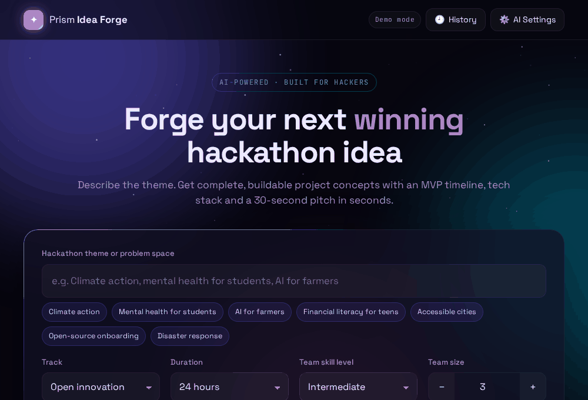
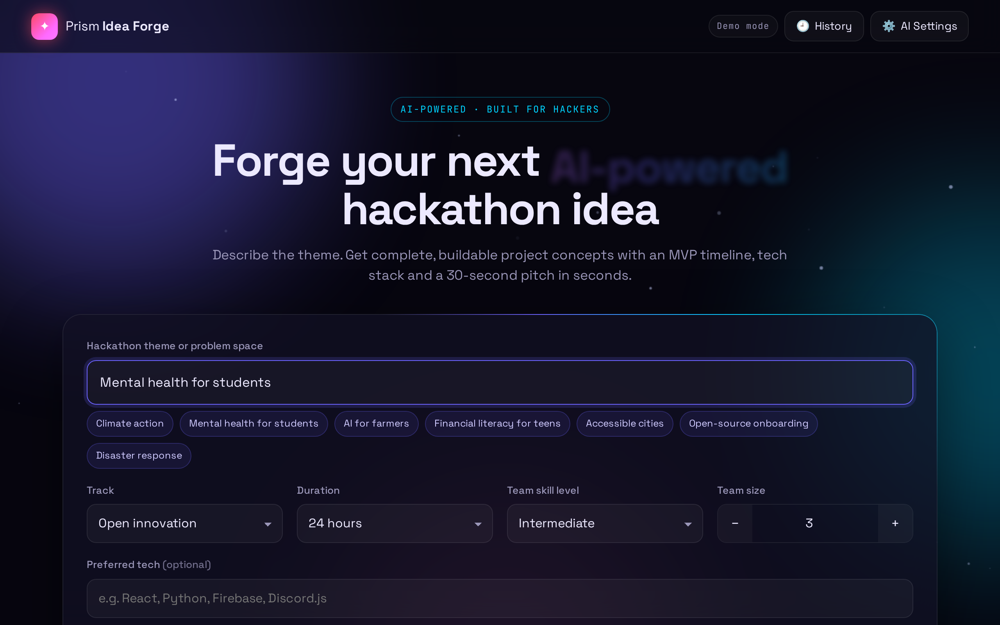
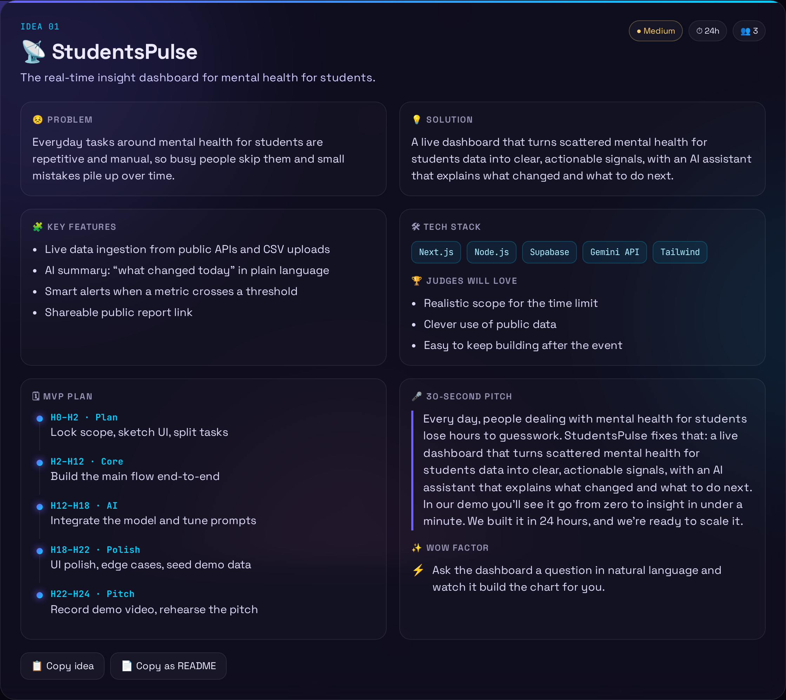
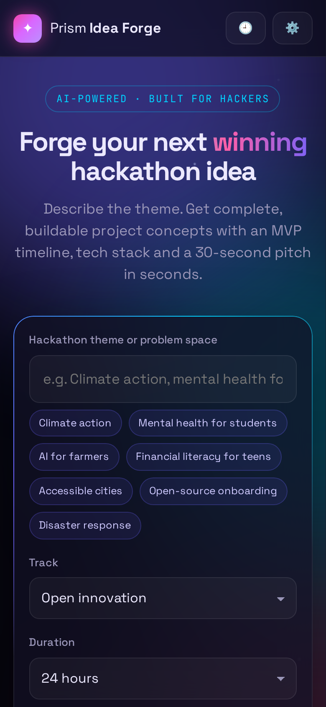
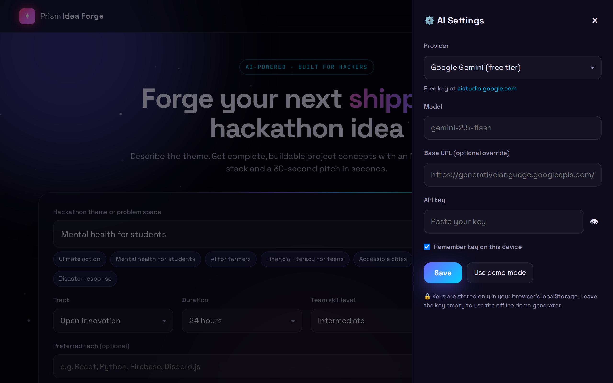
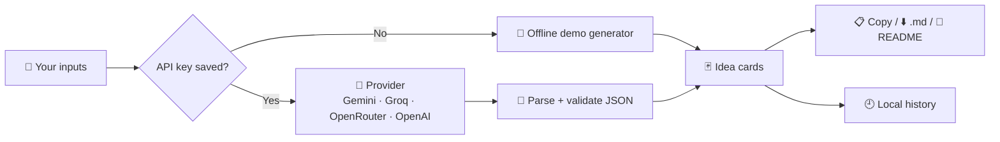

<!-- ═════════════ HEADER ═════════════ -->
<p align="center">
  
</p>

<p align="center">
  
</p>

<p align="center">
  <a href="https://krishyaa06.github.io/prism-idea-forge/"></a>
  
  
  
  
  <a href="LICENSE"></a>
</p>

<p align="center">
  <a href="https://krishyaa06.github.io/prism-idea-forge/"></a>
</p>


## ⚡ Overview

Stuck at the start of a hackathon? **Prism Idea Forge** turns a theme into complete, buildable project ideas in seconds.
Every idea comes with the problem, the solution, key features, a tech stack, an **hour-by-hour MVP plan** that fits your hackathon length, a **30-second pitch**, a wow factor and what judges will love. One click gives you a ready **README starter** for your repo.

- 🆓 **Works without any key.** Demo mode uses a built-in offline generator
- 🤖 **Bring your own AI.** Gemini (free), Groq (free), OpenRouter, OpenAI or any OpenAI-compatible endpoint
- 🔒 **Private by design.** No backend. Your key stays in your browser and is sent only to the provider you choose

👉 **Try it now:** [krishyaa06.github.io/prism-idea-forge](https://krishyaa06.github.io/prism-idea-forge/)

## 📸 Screenshots

<p align="center"><br><sub>Home: theme, track, duration, skill level, team size and preferred stack</sub></p>

<table>
  <tr>
    <td width="62%"><p align="center"><b>Idea card</b> with MVP plan and pitch</p></td>
    <td width="38%"><p align="center"><b>Mobile</b> layout</p></td>
  </tr>
  <tr>
    <td colspan="2"><p align="center"><b>AI Settings</b> drawer (provider, model, key)</p></td>
  </tr>
</table>

## ✨ Features

| | Feature | Details |
|---|---------|---------|
| 🎯 | **Smart inputs** | Theme (with quick chips), 10 tracks, 12h to 1 week, skill level, team size 1 to 6, preferred stack, 1 to 3 ideas |
| 🧠 | **Complete ideas** | Problem, solution, features, tech stack, difficulty, MVP timeline, pitch, wow factor, judge hooks |
| 📋 | **Export** | Copy one idea, copy everything as Markdown, download a `.md` file or copy a README starter |
| 🕘 | **History** | Last 20 generations saved locally, reopen with one click |
| ⌨️ | **Shortcuts** | `Ctrl + Enter` / `⌘ + Enter` to forge |
| ✨ | **Animations** | Starfield background, rotating hero word, glowing cards, step-by-step loading log |
| 📱 | **Responsive** | Works on phones, tablets and desktops |
| 🛡️ | **Robust** | Validates and cleans AI output, friendly errors, a new request safely cancels the previous one |

## 🤖 AI Providers

| Provider | Default model | Free key |
|----------|---------------|:--------:|
| **Demo mode** | Built-in offline generator | No key needed |
| **Google Gemini** | `gemini-2.5-flash` | ✅ [aistudio.google.com](https://aistudio.google.com/apikey) |
| **Groq** | `llama-3.3-70b-versatile` | ✅ [console.groq.com](https://console.groq.com/keys) |
| **OpenRouter** | `meta-llama/llama-3.3-70b-instruct:free` | ✅ [openrouter.ai](https://openrouter.ai/keys) |
| **OpenAI** | `gpt-4o-mini` | [platform.openai.com](https://platform.openai.com/api-keys) |
| **Custom** | Any model | Any OpenAI-compatible `/chat/completions` URL (LM Studio, Ollama, Together, ...) |

**How to switch on AI mode:** open **⚙️ AI Settings** → pick a provider → paste your key → **Save**. The pill at the top changes from *Demo mode* to the provider name. Untick **Remember key** to keep it only for the current tab session.

> 🔐 Keys are stored only in your browser's `localStorage` (or in memory if you untick "Remember"). There is no server, analytics or tracking.

## 🔄 How it works



## 🚀 Run Locally

No build step and no dependencies. Any static server works:

```bash
git clone https://github.com/krishyaa06/prism-idea-forge.git
cd prism-idea-forge
python3 -m http.server 8080      # or: npx serve .
```

Open <http://localhost:8080>.

### Deploy your own

Fork the repo → **Settings → Pages → Deploy from branch → `main` / root**. It also works on Netlify, Vercel or Cloudflare Pages as a plain static site.

## 📁 Project Structure

```
prism-idea-forge/
├── index.html        # layout, form, drawers
├── style.css         # glassmorphism theme + animations
├── js/
│   ├── providers.js  # provider presets + callChat()
│   ├── demo.js       # offline idea generator
│   └── app.js        # UI, prompt, validation, export, history
└── assets/screenshots/
```

## 🗺️ Roadmap

- [x] Multi-provider AI + offline demo mode
- [x] MVP plan scaled to hackathon length
- [x] Markdown / README export and history
- [ ] Share an idea with a link
- [ ] Pitch deck outline export
- [ ] Team role suggestions

## 🤝 Contributing

1. Fork the repo
2. Create a branch: `git checkout -b feature/amazing-idea`
3. Commit and open a Pull Request

New themes, tracks or demo templates in `js/demo.js` are very welcome.

## 👤 Author

<table>
  <tr>
    <td align="center">
      <a href="https://github.com/krishyaa06"><br><b>Soumya Bhandare</b></a><br>
      <sub>Founder @ Prism Protocol</sub>
    </td>
    <td>
      <a href="https://dc.gg/prismprotocol"></a><br>
      <a href="https://instagram.com/prism_protocol_"></a><br>
      <a href="https://x.com/krishyaa06"></a>
    </td>
  </tr>
</table>

## 📄 License

Released under the [MIT License](LICENSE).

<p align="center">
  <b>If you like this project, consider giving it a ⭐</b><br>
  <sub>"Build. Create. Compete." · Made with ⚡ by Prism Protocol</sub>
</p>


